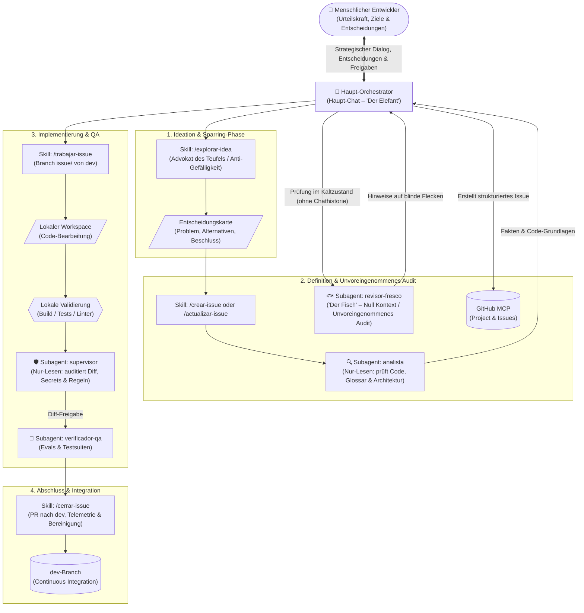

Vor einiger Zeit habe ich einen Weg eingeschlagen, der heute einen zentralen Teil meines Alltags einnimmt: zu erforschen, wie künstliche Intelligenz die Art und Weise, wie wir Software entwickeln, von Grund auf verändern kann.

Das ursprüngliche Ziel klang simpel, fast wie aus dem Lehrbuch: **so viele mechanische Routineaufgaben wie möglich im Alltag zu automatisieren – sowohl für mich selbst als auch für mein Team**. Ich wollte den operativen Ballast aus dem Weg räumen, damit wir uns auf das konzentrieren können, was wirklich den Unterschied macht: abstrakte Ideen durchdenken, das große Ganze im Blick behalten und bessere Systeme entwerfen.

Doch sobald man den Schritt vom Ausprobieren von Prompts in einem Chatfenster hin zum Bau eines echten Systems macht, das im Entwicklerteam produktiv eingesetzt wird, stößt man unweigerlich auf zwei unverhandelbare Grundsätze:

> **1. Denken kann nicht delegiert werden.**  
> **2. Zwischenmenschliche Beziehungen können ebenso wenig delegiert werden.**

Künstliche Intelligenz ist ein gewaltiger Hebel. Aber sie ist nicht dazu da, unseren Verstand zu ersetzen oder uns von menschlicher Empathie zu entbinden. Dies in der Praxis zu begreifen, ist keine philosophische Debatte, sondern eine fundamentale kulturelle und technische Herausforderung.

---

### Das lebendige Labor: Juniors, Seniors und das Dilemma des Handwerkers

Ich habe das Glück und den Vorteil, ein kleines Team zu leiten. Das verschafft uns einen unschätzbaren Vorteil: die Agilität, Dinge direkt an der Front zu erproben, unmittelbares Feedback zu erhalten, was funktioniert und was nicht, und unsere Werkzeuge in Echtzeit anzupassen.

In diesem Alltag sticht eine Erkenntnis sofort hervor: Der Einsatz von KI-Agenten wirkt sich je nach Erfahrungsstufe völlig unterschiedlich aus:

- **Für Junior-Entwickler ist es ein Beschleuniger:** Es bietet ihnen ein enormes Auffangnetz. Ein solides Set automatisierter Werkzeuge stellt sicher, dass keine Git-Branches beschädigt werden, leitet sie bei der Formulierung klarer Akzeptanzkriterien an, validiert Änderungen lokal und konfrontiert sie mit sauberen Codemustern. Es ersetzt sie nicht – es nimmt ihnen die Angst vor dem leeren Blatt und beschleunigt ihre Lernkurve um Monate innerhalb weniger Wochen.

- **Für Senior-Entwickler ist es eine Identitätsfrage:** Und genau hier findet der tiefgründigste Dialog statt. Ein erfahrener Entwickler liebt oft das klassische Handwerk: Code Zeile für Zeile zu schreiben, die feine Kontrolle über jede Funktion zu behalten und über Kommas oder Semikolons zu diskutieren. Wenn eine KI beginnt, die Implementierung zu entwerfen, entsteht ein echtes Unbehagen: *Denke ich überhaupt noch mit, wenn ich nicht jede Zeile selbst tippe? Wann bin ich zu einer Fabrik geworden, die wie am Fließband Issues abarbeitet?*

Die Antwort, die wir gemeinsam erarbeiten: Die Rolle schrumpft nicht, sie wächst. Man diktiert der Maschine nicht mehr bei jedem Schritt mikrotaktische Syntax. Die eigentliche Aufgabe besteht nun darin, die Richtung vorzugeben, Governance-Regeln für das Repository zu verfassen, Systemgrenzen zu ziehen und jene architektonischen Entscheidungen zu treffen, die eine KI weder treffen kann noch sollte.

Der Senior ist nicht länger der Maurer, der jeden einzelnen Stein setzt, sondern der Architekt, der garantiert, dass das Gebäude stabil steht. Ein Problem in Abstraktionen zu durchdringen, erfordert **mehr** Denkarbeit, nicht weniger.

---

### Von einzelnen Skripten zum System: Was ich beim Bau von AgentToolkit gelernt habe

Um diesen Qualitätssprung ohne Chaos oder voreilige Gefälligkeit zu meistern, reicht es nicht, ein Standard-Chatfenster zu öffnen und das Sprachmodell um Hilfe zu bitten. Wir brauchten eine wiederholbare Methode.

So entstand [AgentToolkit](https://github.com/datoscohen/AgentToolkit) – ein Projekt, das mit drei einfachen Skripten zur Strukturierung des Git-Workflows begann (`crear-issue`, `trabajar-issue`, `cerrar-issue`) und inzwischen über 170 Commits an gesammelter Praxiserfahrung umfasst.

Der Bau dieses Toolkits zwang mich dazu, reale Probleme zu lösen, die in Marketing-Demos verschwiegen werden:

#### 1. Gefälligkeit ist der lautlose Feind (*Sycophancy*)
Große Sprachmodelle neigen von Natur aus dazu, dem Nutzer nach dem Mund zu reden. Kommt man mit einer unausgereiften oder fehlgeleiteten Idee, neigt das Modell dazu, vorschnell Code zu schreiben oder Aufgaben auf falschen Annahmen aufzubauen. Es konvergiert, bevor es hinterfragt.
Deshalb haben wir gezielte **Sparring-Mechanismen** geschaffen (wie den Skill `/explorar-idea`): Anweisungen, die explizit als Advokat des Teufels agieren, bevor eine einzige Zeile Code geändert wird. Sie zwingen uns dazu, versteckte Kosten, einfachere Alternativen oder die gesündeste Option zu prüfen: **schlicht gar nichts zu tun**.

#### 2. Spezialisierte Nur-Lese-Subagenten
Einem einzelnen monolithischen Agenten unbegrenzte Rechte zu geben, führt unweigerlich ins Chaos. Wir haben die Aufgaben in klare Rollen mit eng begrenzten Kontextbudgets aufgeteilt: Subagenten, die ausschließlich Code und Architektur analysieren (`analista`), Subagenten, die Codequalität, Sicherheitsregeln und Secrets auditieren (`supervisor`), sowie dedizierte Helfer für externe Systeme. Der Hauptagent implementiert und validiert lokal; alle anderen beobachten, messen und prüfen, ohne den Code zu verändern.

#### 3. Das Muster „Elefant und Fische“
Wenn man dreißig Minuten lang eine Anforderung im Chat diskutiert, häuft der koordinierende Agent (der Elefant) den gesamten Gesprächsverlauf an und erliegt dem Bias des geteilten Kontexts: Er hält Dinge für selbstverständlich, die zwar besprochen, aber nirgendwo im Ticket niedergeschrieben wurden.
Um dies zu lösen, setzen wir einen kurzlebigen Subagenten ohne Gedächtnis ein (den Fisch, `revisor-fresco`), der ausschließlich das fertige Textdokument prüft. Versteht er den Text nicht oder entdeckt er lose Annahmen, liegt das daran, dass Mensch oder Elefant stillschweigend Magie vorausgesetzt haben.

---

### Wie Agenten und Skills zusammenarbeiten

Das folgende Diagramm veranschaulicht das Zusammenspiel zwischen dem menschlichen Entwickler, dem Hauptorchestrator und den spezialisierten Subagenten und Skills entlang des gesamten Lebenszyklus einer Aufgabe:

---

### Der Blick nach vorn

Den Arbeitsalltag zu automatisieren bedeutet keineswegs, sich vom Code abzuwenden oder die Softwareentwicklung in eine seelenlose Fabrik zu verwandeln. Ganz im Gegenteil: Es befreit uns von mechanischer Fließbandarbeit, damit wir uns auf das zutiefst Menschliche besinnen können.

Die Beziehungen im Team zu pflegen, echte Empathie für die Nutzer unserer Software aufzubringen, aufmerksam zuzuhören und mit klarem Urteilsvermögen zu entscheiden, was es überhaupt wert ist, gebaut zu werden – das sind Aufgaben, die uns kein Sprachmodell abnehmen kann.

Dies ist erst der Beginn einer längeren Reise. In kommenden Beiträgen werde ich im Detail beleuchten, wie wir die einzelnen technischen Komponenten entwerfen, wie wir den realen Tokenverbrauch pro Aufgabe messen und welche schmerzhaften Fehler uns auf diesem Weg am meisten gelehrt haben.

Die Maschine mag die Syntax schreiben. Die Urteilskraft bleibt bei uns.
