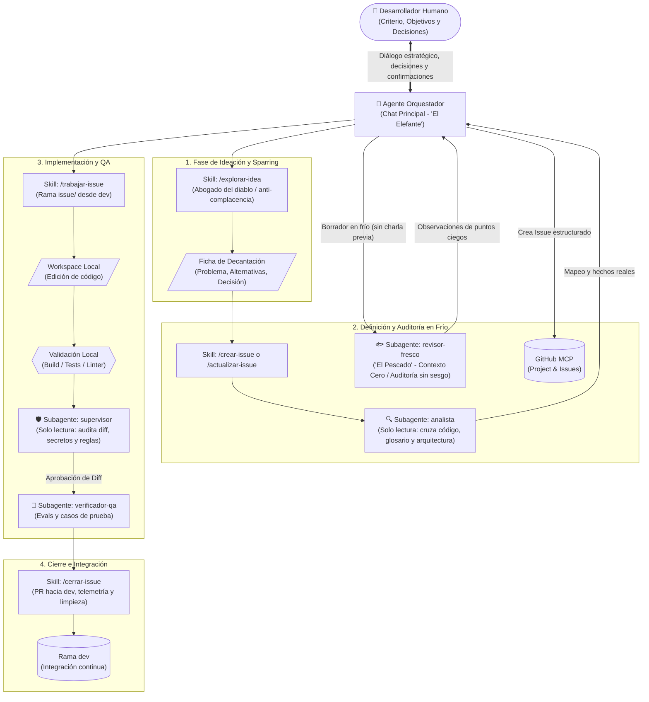

Hace un tiempo empecé un camino que hoy ocupa una parte central de mis días: explorar cómo la inteligencia artificial puede transformar de raíz la forma en que trabajamos. 

El objetivo inicial parecía simple, casi de manual: **automatizar la mayor cantidad posible de tareas mecánicas del día a día, tanto las mías como las del equipo con el que trabajo**. Quería despejar la mesa de fricción operativa para que pudiéramos concentrarnos en lo que realmente mueve la aguja: pensar en ideas más abstractas, mirar el panorama macro y diseñar mejores soluciones.

Pero a medida que pasás de jugar con prompts en un chat a construir un sistema real que convive con un equipo de desarrollo, te chocás de frente con dos verdades que se convirtieron en mi brújula innegociable:

> **1. No se puede delegar el pensar.**  
> **2. Tampoco se puede delegar la relación humana.**

La inteligencia artificial es un potenciador descomunal, pero no viene a reemplazar la cabeza ni a eximirnos de la empatía. Y entender esto en la práctica no es un debate filosófico: es un desafío cultural y técnico de ingeniería.

---

### El laboratorio vivo: juniors, seniors y el dilema del artesano

Tengo la suerte y el beneficio de liderar un equipo pequeño. Eso nos da una ventaja invaluable: la agilidad de probar cosas en el barro, recibir feedback inmediato sobre lo que funciona y lo que no, y orquestar las herramientas en tiempo real.

En ese día a día, lo primero que salta a la vista es que la adopción de agentes de IA tiene un impacto completamente asimétrico según el seniority:

- **Para un desarrollador Junior, es un propulsor:** Les da un marco de contención enorme. Un buen set de herramientas automatizadas les asegura que no rompan ramas de Git, los guía en cómo redactar un criterio de aceptación claro, les valida localmente los cambios y les muestra patrones de código robustos. No los reemplaza: les saca el miedo a la hoja en blanco y acelera su curva de aprendizaje meses en cuestión de semanas.

- **Para un desarrollador Senior, es un desafío de identidad:** Y acá está la conversación más profunda. A un senior muchas veces le apasiona el oficio del artesano: escribir el código, tener el control fino de cada función, discutir si va una coma o un punto y coma. Cuando la IA empieza a redactar la implementación, surge una incomodidad genuina: *¿Sigo usando la cabeza si no estoy tecleando cada línea? ¿En qué momento me convertí en una máquina de hacer chorizos que despacha issues sin parar?*

La respuesta que venimos descubriendo juntos es que el rol no se achica; se eleva. Ya no le decís a la máquina el detalle micro en cada turno de conversación. Tu trabajo pasa a ser definir el rumbo, diseñar las reglas de gobernanza del repositorio, plantear los límites del sistema y tomar las decisiones de arquitectura que la IA no puede ni debe tomar. 

El senior deja de ser el albañil que coloca cada ladrillo para convertirse en el arquitecto que garantiza que el edificio no se caiga. Pensar el problema desde la abstracción exige **más** cabeza, no menos.

---

### De scripts sueltos a un sistema: qué aprendí armando AgentToolkit

Para que este salto de nivel sea posible sin caer en el caos ni en la complacencia, no alcanza con abrir una ventana de chat genérica y pedirle cosas al modelo. Necesitábamos un método repetible.

Así nació [AgentToolkit](https://github.com/datoscohen/AgentToolkit), un proyecto que arrancó con tres scripts básicos para ordenar el flujo de trabajo (`crear-issue`, `trabajar-issue`, `cerrar-issue`) y que hoy superó los 170 commits de aprendizajes acumulados en producción.

Diseñar este toolkit me obligó a resolver problemas que nadie te cuenta en las demos de marketing:

#### 1. La complacencia es el enemigo silencioso (*Sycophancy*)
Los modelos de lenguaje tienen una tendencia natural a decirte que sí a todo. Si venís con una idea floja de papeles o mal enfocada, el modelo suele apurarse a escribir código o armar una tarea sobre premisas equivocadas. Convergen antes de cuestionar.
Por eso creamos mecanismos de **sparring** (como la skill `explorar-idea`): instrucciones diseñadas específicamente para hacer de abogado del diablo antes de tocar una sola línea de código, obligándonos a evaluar costos ocultos, alternativas más simples o incluso la opción más sana: **no hacer nada**.

#### 2. Subagentes especializados y en solo lectura
Darle permisos ilimitados a un único agente para que haga todo es una receta para el desastre. Separamos el trabajo en roles con presupuestos de contexto acotados: subagentes que únicamente relevan y analizan (`analista`), subagentes que auditan calidad y reglas de seguridad (`supervisor`) y agentes acotados para interactuar con sistemas externos. El agente principal implementa y valida localmente; los demás miran, miden y auditan sin tocar el código.

#### 3. El patrón "Elefante y pescados"
Cuando pasás media hora debatiendo un requerimiento en el chat, el agente orquestador (el elefante) acumula toda la memoria de la charla y sufre de sesgo de contexto compartido: da por sentadas cosas que se hablaron pero que nunca quedaron escritas en el issue. 
Para resolver esto, sumamos un subagente efímero y sin memoria (el pescado, `revisor-fresco`) que recibe únicamente el texto final en frío. Si él no lo entiende o ve supuestos en el aire, es porque el humano o el elefante asumieron magia.

---

### Cómo interactúan los agentes y las skills

Para bajar esto a tierra, el siguiente diagrama muestra la coreografía exacta entre el desarrollador humano, el orquestador principal y los subagentes y skills especializados a lo largo de todo el ciclo de vida de una tarea:

---

### Hacia dónde vamos

Automatizar el día a día no es desentenderse del código ni convertir el desarrollo de software en una línea de montaje desalmada. Es justamente lo contrario: es sacarnos de encima el trabajo robótico para volver a lo profundamente humano.

La relación con el equipo, la empatía con quien va a usar lo que construís, la escucha activa y el juicio crítico para decidir qué vale la pena construir y qué no, son cosas que ningún modelo de lenguaje puede hacer por nosotros.

Este es solo el primer paso de un camino que recién empieza. En los próximos posteos voy a ir abriendo el capó de cómo diseñamos cada pieza técnica, cómo medimos el consumo real de tokens por tarea y qué errores nos costaron más caros en este viaje.

La máquina puede escribir la sintaxis. El criterio sigue siendo nuestro.
