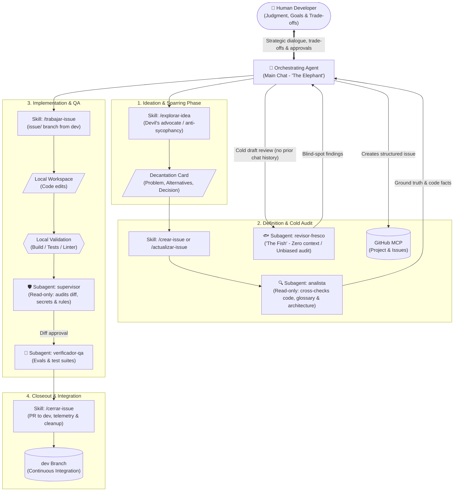

Some time ago, I embarked on a journey that now occupies a central part of my days: exploring how artificial intelligence can fundamentally transform the way we build software.

The initial goal sounded straightforward, almost textbook: **automate as many mechanical, repetitive day-to-day tasks as possible, both for myself and for the team I work with**. I wanted to clear the operational friction off the table so we could focus on what truly moves the needle: reasoning through abstract ideas, looking at the macro picture, and designing better systems.

Yet, as you transition from playing with prompts in a chat window to engineering a real system that lives alongside an engineering team, you run head-on into two non-negotiable compass truths:

> **1. Thinking cannot be delegated.**  
> **2. Human relationships cannot be delegated either.**

Artificial intelligence is an extraordinary multiplier, but it is not here to replace our intellect or excuse us from empathy. Understanding this in practice is not an abstract philosophical debate: it is an engineering and cultural challenge.

---

### The living lab: juniors, seniors, and the craftsman's dilemma

I have the privilege and good fortune of leading a small team. That gives us an invaluable advantage: the agility to test ideas in the trenches, get immediate feedback on what works and what breaks, and orchestrate our tooling in real time.

In our day-to-day work, the first striking takeaway is that agentic AI adoption has a completely asymmetrical impact depending on seniority:

- **For a junior developer, it is a launchpad:** It offers a reassuring framework. A solid set of automated tools ensures they don't break Git branches, guides them in drafting clear acceptance criteria, validates changes locally, and exposes them to robust code patterns. It doesn't replace them—it eliminates the fear of the blank page and accelerates their learning curve by months within weeks.

- **For a senior developer, it is an identity crisis:** And this is where the most meaningful conversation takes place. A senior engineer often loves the craft: writing code by hand, maintaining fine-grained control over every function, and debating commas versus semicolons. When an AI begins drafting implementations, a genuine sense of unease emerges: *Am I still thinking if I’m not typing out every line? Have I turned into a sausage machine, cranking out issues on a conveyor belt?*

The answer we are discovering together is that the role doesn't shrink; it elevates. You no longer instruct the machine on micro tactical syntax with every prompt. Your job shifts to setting direction, authoring repository governance rules, drawing system boundaries, and making the hard architectural trade-offs that an AI cannot and should not make.

The senior engineer transitions from laying every brick to becoming the architect ensuring the building stays upright. Thinking through a problem in abstractions requires **more** brainpower, not less.

---

### From loose scripts to a system: what I learned building AgentToolkit

To enable this shift without collapsing into chaos or complacency, opening a generic chat window and asking an LLM for help simply isn't enough. We needed a repeatable engineering method.

That is how [AgentToolkit](https://github.com/datoscohen/AgentToolkit) was born: an initiative that began with three basic scripts to streamline our Git lifecycle (`crear-issue`, `trabajar-issue`, `cerrar-issue`) and has now surpassed 170 commits of accumulated production learnings.

Designing this toolkit forced me to solve real problems that marketing demos never mention:

#### 1. Sycophancy is the silent killer
Language models have an innate predisposition to please. If you arrive with a half-baked or misguided concept, the model rushes to write code or generate tasks on flawed premises. It converges before questioning.
That is why we designed dedicated **sparring** mechanisms (such as the `/explorar-idea` skill): instructions explicitly tuned to play devil's advocate before touching a single line of code, forcing us to evaluate hidden costs, simpler alternatives, or the healthiest option of all: **doing nothing**.

#### 2. Specialized, read-only subagents
Granting unrestricted privileges to a single monolithic agent is a recipe for disaster. We split responsibilities across distinct roles with tight context budgets: subagents that only inspect and analyze (`analista`), subagents that audit code quality, security rules, and secrets (`supervisor`), and scoped workers for external integrations. The orchestrator implements and validates locally; the rest observe, measure, and audit without touching code.

#### 3. The "Elephant and the Fish" pattern
When you spend half an hour brainstorming a feature in chat, the orchestrating agent (the elephant) accumulates episodic memory and falls victim to shared-context bias: it takes for granted points that were spoken in conversation but never actually written down in the issue.
To solve this, we introduce an ephemeral, zero-memory subagent (the fish, `revisor-fresco`) that reviews only the final written text in isolation. If the fish cannot understand it or spots floating assumptions, it is because either the human or the elephant assumed magic.

---

### How agents and skills interact

To make this architecture concrete, the following diagram maps the exact choreography between the human engineer, the primary orchestrator, and the specialized subagents and skills throughout a task's full lifecycle:

---

### Looking forward

Automating our day-to-day workflow is not about walking away from code, nor is it about turning software engineering into a soulless assembly line. Quite the opposite: it frees us from mechanical toil so we can return to what is deeply human.

Building genuine team relationships, cultivating empathy for the people who use what we build, actively listening, and exercising critical judgment to decide what is worth building in the first place—these are responsibilities no language model can shoulder for us.

This is just the first step in a much larger journey. In upcoming posts, I will lift the hood on how we architect each technical component, how we track actual token consumption per task, and which hard-learned mistakes taught us the most along the way.

The machine can write the syntax. The judgment remains ours.
